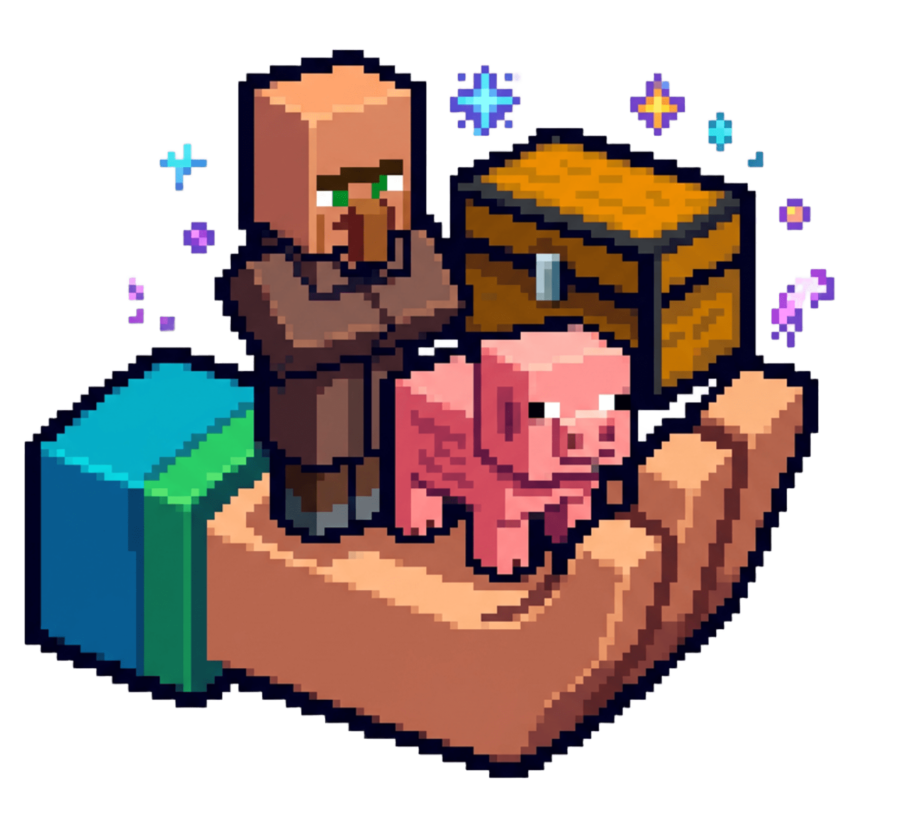
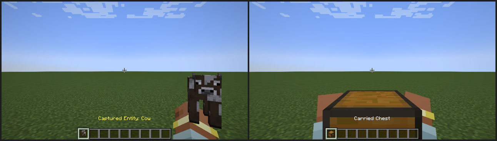

<p align="center">
  
</p>

# Pocket-Everything

Mod **Fabric 1.21.1** (Java 21) qui permet de **capturer n'importe quelle créature** (mob, animal, villageois) à mains nues et de la transporter sous forme d'objet, puis de la relâcher ailleurs avec toutes ses propriétés intactes. Il permet aussi de **porter un coffre, une Toolbox de Create ou tout autre bloc à inventaire** dans les deux mains, contenu compris, et de le reposer à l'identique.



## Sommaire

- [Fonctionnalités](#fonctionnalités)
- [Prérequis](#prérequis)
- [Compiler et installer la version Fabric 1.21.1](#compiler-et-installer-la-version-fabric-1211)
- [Utilisation](#utilisation)
- [Configuration](#configuration)
- [Structure du projet](#structure-du-projet)
- [Compiler et développer](#compiler-et-développer)
- [Tests](#tests)
- [Versionnage](#versionnage)
- [Contribuer](#contribuer)
- [Licence](#licence)

## Fonctionnalités

**Capture de créatures** (objet `pocket_everything:captured_entity`)
- Capture par un geste simple : accroupi + clic droit, main vide, sur la créature.
- Conservation de tout l'état de l'entité (NBT) : points de vie, nom, variante (couleur, race…), âge, inventaire et équipement, métier, niveau et échanges des villageois, propriétaire des animaux apprivoisés, selle…
- Relâche sur n'importe quel bloc, avec refus propres (espace trop bas, hostile en difficulté Pacifique) qui gardent l'objet.
- Rendu 3D exact de la créature capturée (inventaire, main, sol, cadre), à une échelle adaptée à sa taille, et bras du joueur visible qui la tient.
- Liste noire modifiable (joueurs, dragon, Wither, bateaux, wagonnets, cadres, tableaux, support d'armure, nœud de laisse).

**Bloc porté** (objet `pocket_everything:carried_chest`)
- Blocs portables par défaut : le coffre, le coffre piégé et la **Toolbox de Create** (si Create est installé). Contenu, nom, orientation, couleur et table de butin non ouverte conservés ; les blocs déjà posés se prennent sans migration.
- Exclus par défaut : l'**Item Vault** de Create et les blocs multiples (ils se reconstruisent à la pose et dupliqueraient ou casseraient la structure).
- Rendu : le bloc porté est affiché avec son vrai modèle ; un bloc inconnu retombe sur un coffre simple.
- Tout autre bloc à inventaire s'ajoute par datapack (voir [Ajouter un bloc par datapack](#ajouter-un-bloc-par-datapack)).
- Coffre tenu à deux bras, en première et troisième personne, visible des autres joueurs ; main secondaire bloquée pendant le port.
- Objet lâché ou laissé à la mort invulnérable et sans disparition.
- Pose et prise transactionnelles : rien n'est perdu ni dupliqué en cas d'échec.

**Général** : textes en anglais et en français, configuration commune client/serveur, protections respectées (zone de spawn, coffre verrouillé, modes Aventure et Spectateur).

## Prérequis

| Pour… | Il faut |
|---|---|
| Jouer | Minecraft Java Edition **1.21.1**, **Fabric Loader 0.17.3 ou plus récent** et **Fabric API** (testé avec 0.116.17+1.21.1), Java 21 |
| Compiler | **JDK 21** et accès à Internet (Gradle 8.14.3 est téléchargé par le script `gradlew`) |
| Lancer le jeu de développement | Compte Minecraft non requis : le client de développement démarre en mode hors ligne |

Le mod est requis des deux côtés : le client pour l'affichage, le serveur pour la logique.

### Versions prises en charge

| Élément | Prise en charge |
|---|---|
| Minecraft 1.21.1 | Oui (seule version visée). |
| Fabric Loader | 0.17.3 ou plus récent (borne basse `fabric_loader_version` de `gradle.properties`, injectée dans `fabric.mod.json`). |
| Fabric API | Requise ; testée en 0.116.17+1.21.1. |
| Quilt, NeoForge, Forge | Non : cette branche (`fabric-1.21.1`) ne vise que Fabric. La version NeoForge est sur `main`. |

**Message de Fabric sur une dépendance manquante :** installer Fabric API dans `mods/`. Supprimer tout ancien `pocket-everything-*.jar` du dossier `mods/` du client **et** du serveur avant d'y copier `pocket-everything-fabric-1.21.1.jar`.

## Compiler et installer la version Fabric 1.21.1

### Utiliser le mod

1. Installer Fabric Loader pour Minecraft 1.21.1 (lanceur officiel ou launcher de votre choix), puis copier **Fabric API** dans `mods/`.
2. Supprimer tout ancien `pocket-everything-*.jar` du dossier `mods/` du client **et** du serveur, puis copier `deliverable/pocket-everything-fabric-1.21.1.jar` dans ces deux dossiers `mods/`.
3. Lancer le jeu ou le serveur avec le profil Fabric. Le fichier de configuration `config/pocket_everything.json` est créé au premier démarrage.

### Compiler le jar depuis les sources

Depuis la racine du projet (le dossier qui contient `build.gradle`) :

```bash
./gradlew build
```

Sous Windows, utiliser `gradlew.bat build` (cmd) ou `.\gradlew.bat build` (PowerShell). Le jar est produit dans `build/libs/pocket-everything-fabric-1.21.1.jar`. Schéma du nom : `pocket-everything-<loader>-<version-minecraft>.jar`, avec `mod_loader` et `minecraft_version` de `gradle.properties` (la version du mod n'y figure pas).

Si plusieurs Java sont installés, `JAVA_HOME` doit pointer sur un JDK 21 ; à défaut, Gradle télécharge lui-même un JDK 21 (greffon *foojay*).

## Utilisation

### Capturer et relâcher une créature

| Action | Geste |
|---|---|
| Capturer | Accroupi (Sneak) + clic droit, **main vide**, sur la créature |
| Relâcher | Clic droit avec l'objet sur un bloc |

- La capture fonctionne en mode Survie ou Créatif, même inventaire plein (l'objet arrive dans la main vide). Elle est ignorée en Aventure et Spectateur, en zone de spawn protégée, et refusée pour les animaux apprivoisés d'un autre joueur.
- La créature réapparaît sur la face visée du bloc ; l'objet est consommé.
- L'infobulle de l'objet indique la créature, son nom et sa vie (par exemple « Captured Entity: Cow » en anglais, « Entité capturée : Vache » en français).

### Porter un coffre ou un autre bloc à inventaire

| Action | Geste |
|---|---|
| Prendre | Accroupi + clic droit, **les deux mains vides**, sur un coffre, un coffre piégé ou une Toolbox de Create |
| Poser | Clic droit avec le coffre porté sur un bloc |

- Coffre double : seule la moitié visée est prise, l'autre devient un coffre simple.
- Toolbox de Create : prise et reposée avec son contenu et sa couleur ; l'Item Vault est refusé sans message (il reste un bloc normal).
- Refus avec message : coffre verrouillé, zone protégée, main secondaire occupée, coffre contenant déjà un coffre porté (même caché dans un shulker), contenu de plus de 1 Mio.
- La ligne de commande permet de s'en procurer un exemplaire vide pour essayer : `/give @s pocket_everything:carried_chest`.

### Essayer le mod en développement

```bash
./gradlew runClient
```

Créer un monde, puis par exemple :

```
/gamemode survival
/summon minecraft:villager ~ ~ ~
```

Se mettre accroupi et faire un clic droit sur le villageois avec la main vide : il disparaît et l'objet apparaît dans la main. Un clic droit sur le sol le relâche avec son métier, son niveau et ses échanges. Le guide `TEST_GUIDE.md` détaille une liste complète de vérifications manuelles.

Pour un serveur de développement : `./gradlew runServer` (le serveur ne s'arrête pas seul : taper `stop` dans sa console).

## Configuration

Fichier `config/pocket_everything.json` (créé au premier lancement, dans `run/config/` en développement) :

| Option | Défaut | Rôle |
|---|---|---|
| `allowHostile` | `true` | Autorise la capture de monstres hostiles (zombies, creepers…). |
| `carryChestsEnabled` | `true` | Active la prise et la pose de coffres. À `false`, le geste ouvre le coffre normalement. |
| `extraBlacklist` | `[]` | Identifiants d'entités supplémentaires interdits, par exemple `["minecraft:warden"]`. |

Si le fichier est absent, il est créé avec ces valeurs ; s'il est illisible ou invalide, les valeurs par défaut sont utilisées et un avertissement est journalisé. Il est lu au démarrage (redémarrer pour appliquer un changement).

La liste noire de base est une étiquette de données modifiable par datapack : `data/pocket_everything/tags/entity_type/blacklist.json`. Les blocs portables sont dans `data/pocket_everything/tags/block/carryable_chests.json` (`minecraft:chest`, `minecraft:trapped_chest` et `create:toolbox`), les exclusions dans `never_carryable.json` (`create:item_vault`).

### Ajouter un bloc par datapack

Un bloc est portable s'il est dans l'étiquette `pocket_everything:carryable_chests`, **n'est pas** dans `pocket_everything:never_carryable` (prioritaire) et possède une block entity. Exemple, dans un datapack, pour porter un tonneau avec son contenu : `data/pocket_everything/tags/block/carryable_chests.json`

```json
{
  "replace": false,
  "values": ["minecraft:barrel", { "id": "unmod:boite", "required": false }]
}
```

et pour interdire un bloc (même s'il est listé ailleurs) : `data/pocket_everything/tags/block/never_carryable.json`

```json
{
  "replace": false,
  "values": ["minecraft:barrel"]
}
```

`"required": false` évite une erreur si le mod du bloc n'est pas installé. Les protections (verrou, zone protégée, mode Aventure) s'appliquent à tout bloc portable.

## Structure du projet

```
build.gradle, gradle.properties   Construction (Fabric Loom) et versions du mod
src/main/java/fr/pocketeverything/
  PocketEverything.java                    Point d'entrée du mod (ModInitializer)
  capture/                        Capture et relâche des créatures
  chest/                          Prise et pose des coffres
  config/                         Options de configuration
  data/                           Composants de données des deux objets
  event/                          Gestionnaires d'événements Fabric (clics, main secondaire…)
  mixin/                          Mixins (échange de mains, pose de bras)
  item/                           Objets Captured Entity et Carried Chest
  registry/                       Enregistrement des objets et des composants
  client/                         Rendu (modèles, bras, échelle) et point d'entrée client
src/main/resources/               Langues, modèles, étiquettes, fabric.mod.json, mixins, logo.png et pack.png
src/test/                         Tests unitaires JUnit 5
src/gametest/                     Tests de jeu (GameTests Fabric), hors du jar
src/dev/                          Outil de captures d'écran du client de développement
tools/                            Générateur de la structure vide des GameTests, déclinaisons du logo (make_logo.py)
deliverable/                      Jar prêt à installer
docs/                             Crédits, logo et images du README
TEST_GUIDE.md                     Guide de test manuel
```

## Compiler et développer

| Commande | Effet |
|---|---|
| `./gradlew build` | Compile, exécute les tests unitaires, produit `build/libs/pocket-everything-fabric-1.21.1.jar` |
| `./gradlew runClient` | Lance un client Minecraft de développement avec le mod |
| `./gradlew runServer` | Lance un serveur de développement |
| `./gradlew runScreenshot` | Lance le client, prend des captures dans `build/screenshots/` |
| `./gradlew runGameTest` | Lance les GameTests sur un serveur Fabric |

La version du mod, celle de Minecraft, de Fabric Loader et de Fabric API sont dans `gradle.properties`.

## Tests

```bash
./gradlew test               # tests unitaires JUnit 5 (src/test)
./gradlew runGameTest        # tests de jeu (src/gametest), code de sortie 1 si l'un échoue
```

Les tests de jeu simulent des joueurs dans un monde réel : capture, relâche, villageois, coffre rempli, bloc à inventaire non-coffre (bloc de test hors du jar), sauvegarde et rechargement, mort et récupération, changement de dimension, serveur dédié, cas limites.

## Versionnage

Le numéro de version est `MAJEUR.MINEUR.PATCH`. Sa **seule source de vérité** est `mod_version` dans `gradle.properties` : il est injecté dans `fabric.mod.json` (donc affiché dans la liste des mods), dans le nom du jar et dans une ligne du journal au démarrage. Le journal des changements est `CHANGELOG.md`, chaque version livrée porte un tag git `vX.Y.Z`.

À chaque demande livrée, on détermine le type de changement et on incrémente, sans jamais réutiliser ni sauter un numéro :

| Type de demande | Règle | Exemple |
|---|---|---|
| Normale (correction, petit ajout, ajustement) | +1 sur le dernier numéro (patch) | 1.1.0 → 1.1.1 |
| Gros ajout (nouvelle fonctionnalité importante) | +1 sur le numéro du milieu, patch remis à 0 | 1.1.0 → 1.2.0 |
| Version finale d'un cycle, **uniquement si l'utilisateur l'indique** | +1 sur le premier numéro, les autres remis à 0 | 1.x.x → 2.0.0 |

En cas de doute entre patch et mineur, appliquer la règle ci-dessus et le signaler dans `CHANGELOG.md`.

Procédure de livraison : modifier `mod_version`, ajouter l'entrée datée en tête de `CHANGELOG.md`, mettre à jour le nom du jar cité dans ce README et dans `TEST_GUIDE.md`, lancer `bash .athanor/check.sh` (le test `VersionConsistencyTest` refuse toute incohérence), remplacer le jar de `deliverable/`, committer, puis `git tag vX.Y.Z`.

## Contribuer

1. Créer une branche à partir de `main`.
2. Faire un changement ciblé, accompagné d'un test (JUnit pour la logique pure, GameTest pour le comportement en jeu).
3. Vérifier que `./gradlew build` et `./gradlew runGameTest` réussissent.
4. Ouvrir une demande de fusion en décrivant le comportement modifié et la manière de le tester.

Les messages de commit sont courts, à l'impératif, et décrivent ce que le commit apporte. Tout contenu ajouté doit être original ou sous licence libre, avec sa source notée dans `docs/CREDITS.md`.

## Licence

[MIT](LICENSE). Aucune ressource tierce : voir `docs/CREDITS.md`.
